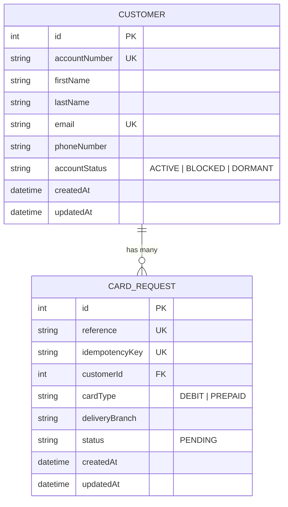

# SecBank Card Request API

[](https://nestjs.com/)
[](https://www.typescriptlang.org/)
[](https://www.prisma.io/)
[](https://vitest.dev/)
[](https://oxc.rs/)

A REST API built with NestJS for a simulated bank–FinTech integration. It supports bank account validation, card request submission with idempotency protection, and card request status lookup. The application uses a local SQLite database containing synthetic customer records to demonstrate the integration workflow.

---

## Table of Contents

- [Features](#features)
- [Architecture & Tech Stack](#architecture--tech-stack)
- [Project Structure](#project-structure)
- [Database Schema & Data Model](#database-schema--data-model)
- [Prerequisites](#prerequisites)
- [Getting Started](#getting-started)
- [Environment Variables](#environment-variables)
- [Seed Data & Test Accounts](#seed-data--test-accounts)
- [API Documentation & Endpoints](#api-documentation--endpoints)
  - [Authentication](#authentication)
  - [Idempotency Mechanism](#idempotency-mechanism)
  - [Validate Account](#1-validate-account)
  - [Submit Card Request](#2-submit-card-request)
  - [Get Card Request Status](#3-get-card-request-status)
- [Quick cURL Examples](#quick-curl-examples)
- [Testing & Quality Assurance](#testing--quality-assurance)
- [Scripts Reference](#scripts-reference)

---

## Features

- **Bank Account Validation:** Validates 10-digit account numbers and determines card-request eligibility based on account status (`ACTIVE`, `BLOCKED`, or `DORMANT`).
- **PII Data Protection & Masking:** Masks account numbers in API responses (for example, `******6789`) to avoid exposing complete account identifiers.
- **Card Request Workflow:** Supports `DEBIT` and `PREPAID` card requests for collection at designated bank branches.
- **Idempotency Protection:** Prevents duplicate submissions through an enforced `Idempotency-Key` header, including concurrent request handling and payload mismatch detection (`HTTP 409`).
- **Unique Request References:** Generates tracking references in the format `SCR-XXXXXXXXXXXX`.
- **API Key Authentication:** Protects partner endpoints using `X-API-Key` authentication and Node.js `timingSafeEqual` to reduce timing-related information leakage.
- **OpenAPI / Swagger Integration:** Provides interactive API documentation and testing through Swagger UI.
- **Automated Testing:** Includes unit tests and end-to-end tests using Vitest and Supertest.

---

## Architecture & Tech Stack

| Component | Technology | Description |
| :--- | :--- | :--- |
| Framework | NestJS 12 | Node.js application framework |
| Language | TypeScript 6 | Static typing and modern JavaScript features |
| Database & ORM | Prisma 6 + SQLite | Database access, models, and migrations |
| Validation | class-validator & class-transformer | Request validation and payload transformation |
| API Documentation | @nestjs/swagger | OpenAPI documentation and Swagger UI |
| Testing | Vitest 4 + Supertest | Unit and end-to-end testing |
| Linter & Formatter | Oxlint & Prettier | Code linting and formatting |

### Application Architecture

The application follows a modular NestJS structure:

- **Accounts Module:** Handles bank account validation and eligibility checks.
- **Cards Module:** Handles card request creation, idempotency checks, and request status retrieval.
- **Prisma Module:** Provides database access through a shared Prisma service.
- **API Key Guard:** Protects the API endpoints from unauthenticated partner requests.

---

## Project Structure

```text
secbank-card-api/
├── prisma/
│   ├── migrations/                 # Version-controlled SQL migration history
│   ├── schema.prisma               # Prisma data models and relationships
│   └── seed.js                     # Sample customer seeding script
├── src/
│   ├── accounts/
│   │   ├── dto/
│   │   │   └── validate-account.dto.ts
│   │   ├── accounts.controller.ts
│   │   ├── accounts.module.ts
│   │   ├── accounts.service.spec.ts
│   │   └── accounts.service.ts
│   ├── cards/
│   │   ├── dto/
│   │   │   └── create-card-request.dto.ts
│   │   ├── cards.controller.ts
│   │   ├── cards.module.ts
│   │   ├── cards.service.spec.ts
│   │   └── cards.service.ts
│   ├── common/
│   │   └── guards/
│   │       ├── api-key.guard.spec.ts
│   │       └── api-key.guard.ts
│   ├── prisma/
│   │   ├── prisma.module.ts
│   │   └── prisma.service.ts
│   ├── app.controller.ts
│   ├── app.module.ts
│   ├── app.service.ts
│   └── main.ts
├── test/
│   └── app.e2e-spec.ts              # End-to-end integration tests
├── .env.example                    # Environment variable template
├── .gitignore
├── package.json
├── prisma.config.ts
├── tsconfig.json
├── vitest.config.ts                # Unit test configuration
└── vitest.config.e2e.ts            # E2E test configuration
```

---

## Database Schema & Data Model

The application uses SQLite with Prisma ORM.

Two primary models represent the data:

### Customer

Stores synthetic bank customer information, including:

- Unique account number
- First and last name
- Unique email address
- Phone number
- Account status

### CardRequest

Stores card request information, including:

- Unique request reference
- Optional unique idempotency key
- Customer relationship
- Card type
- Delivery branch
- Request status
- Creation and update timestamps

### Entity Relationship Diagram



### Business Rules

1. **Account Number:** Must contain exactly 10 digits (`^\d{10}$`).
2. **Eligibility:** Only customers with `accountStatus = ACTIVE` can submit card requests.
3. **Card Types:** Only `DEBIT` and `PREPAID` are accepted.
4. **Request Reference:** Each card request receives a unique reference in the format `SCR-XXXXXXXXXXXX`.
5. **Idempotency:**
   - Repeating a request with the same idempotency key and identical payload returns the existing request.
   - Reusing an idempotency key with a different payload returns `409 Conflict`.
   - A valid idempotency key must contain between 8 and 128 permitted characters.

### Implementation Scope

This assessment uses a local SQLite database containing synthetic customer records to simulate the bank's customer-account data source.

No live core banking system, card-processing service, or physical card issuance provider is integrated.

Card requests are persisted with an initial `PENDING` status, which can be retrieved through the status endpoint. Automated status transitions and actual card fulfillment are outside the current implementation scope.

---

## Prerequisites

Before running the application, ensure you have installed:

- [Node.js](https://nodejs.org/) (20.19+, 22.12+, or a compatible newer version)
- npm (10 or newer)
- Git

---

## Getting Started

### 1. Clone the Repository

```bash
git clone <repository-url>
cd secbank-card-api
```

Replace `<repository-url>` with the actual repository URL.

### 2. Install Dependencies

```bash
npm install
```

### 3. Configure Environment Variables

Create a local `.env` file from the example:

```bash
cp .env.example .env
```

Configure the following variables in `.env`:

```env
DATABASE_URL="file:./dev.db"
PORT=3000
FINTECH_API_KEY="your_secure_fintech_api_key_here"
```

Generate a strong secret for `FINTECH_API_KEY`. Keep the actual `.env` file private and never commit it to version control.

### 4. Generate Prisma Client

```bash
npx prisma generate
```

### 5. Run Database Migrations

```bash
npx prisma migrate dev
```

This creates the local SQLite database and applies the available migrations.

### 6. Seed the Database

Populate the database with synthetic customer records:

```bash
npm run db:seed
```

Expected output:

```text
Successfully seeded 4 customers.
```

### 7. Start the Application

Development mode:

```bash
npm run start:dev
```

Production build:

```bash
npm run build
npm run start:prod
```

The API will be available at:

```text
http://localhost:3000
```

Base API URL:

```text
http://localhost:3000/api/v1
```

Swagger documentation:

```text
http://localhost:3000/api/docs
```

---

## Environment Variables

| Variable | Required | Default | Description |
| :--- | :---: | :--- | :--- |
| `DATABASE_URL` | Yes | `file:./dev.db` | Prisma SQLite database connection string |
| `PORT` | No | `3000` | Port on which the application listens |
| `FINTECH_API_KEY` | Yes | None | Secret API key used to authenticate partner requests |

An example environment file is provided as `.env.example`.

---

## Seed Data & Test Accounts

Running `npm run db:seed` creates or updates four synthetic customer records.

| Account Number | Customer Name | Status | Eligible for Card? | Test Purpose |
| :--- | :--- | :---: | :---: | :--- |
| `0123456789` | John Okafor | `ACTIVE` | Yes | Successful account validation and card request |
| `0123456790` | Mary James | `ACTIVE` | Yes | Alternative active customer |
| `0123456791` | David Bello | `BLOCKED` | No | Blocked account rejection |
| `0123456792` | Sarah Ade | `DORMANT` | No | Dormant account rejection |

These are synthetic records created exclusively for demonstration and testing. They do not represent actual bank customers.

---

## API Documentation & Endpoints

**Base URL**

```text
http://localhost:3000/api/v1
```

**Swagger UI**

```text
http://localhost:3000/api/docs
```

The API exposes three primary endpoints.

| Method | Endpoint | Purpose |
| :--- | :--- | :--- |
| POST | `/accounts/validate` | Validate a bank account |
| POST | `/cards/requests` | Submit a card request |
| GET | `/cards/requests/:reference` | Retrieve a card request's status |

All endpoints require API key authentication.

### Authentication

The FinTech partner must include the `X-API-Key` header in every request.

```http
X-API-Key: your_secure_fintech_api_key_here
```

The API key is compared against the configured `FINTECH_API_KEY` environment variable.

Requests with a missing or incorrect key receive:

**HTTP 401 Unauthorized**

```json
{
  "message": "Missing or invalid API key",
  "error": "Unauthorized",
  "statusCode": 401
}
```

If the server has no configured API key, it returns an internal server error rather than accepting unauthenticated requests.

---

### Idempotency Mechanism

The card request endpoint requires an `Idempotency-Key` header.

```http
Idempotency-Key: demo-idempotency-key-001
```

The key must:

- Contain between 8 and 128 characters.
- Match the permitted character pattern: `^[A-Za-z0-9._:-]{8,128}$`.
- Be unique to the logical request being submitted.

The API handles three scenarios:

| Scenario | Expected Behaviour |
| :--- | :--- |
| First submission with a new key | Creates a new card request |
| Retry with the same key and identical payload | Returns the original request |
| Same key reused with a different payload | Returns `409 Conflict` |

The idempotency mechanism helps prevent duplicate card request records when a FinTech partner retries a request because of a timeout or an uncertain network response.

The implementation also handles concurrent submissions by recovering from a unique-key conflict and checking the existing request.

---

### 1. Validate Account

Checks whether a bank account exists and determines whether the customer is eligible to submit a card request.

**Method:** `POST`

**Endpoint:**

```text
/api/v1/accounts/validate
```

**Headers:**

```http
Content-Type: application/json
X-API-Key: <API_KEY>
```

**Request Body:**

```json
{
  "accountNumber": "0123456789"
}
```

**Successful Response — HTTP 200 OK**

```json
{
  "success": true,
  "message": "Account is valid and eligible for a card request",
  "data": {
    "accountNumber": "******6789",
    "customerName": "John Okafor",
    "accountStatus": "ACTIVE",
    "eligible": true
  }
}
```

**Non-Eligible Account — HTTP 200 OK**

An existing account can be valid but ineligible for a card request.

For example, a blocked account:

```json
{
  "success": true,
  "message": "Account is not eligible for a card request",
  "data": {
    "accountNumber": "******6791",
    "customerName": "David Bello",
    "accountStatus": "BLOCKED",
    "eligible": false
  }
}
```

**Possible Error Responses:**

| Status Code | Description |
| :--- | :--- |
| 400 | Invalid account number format |
| 401 | Missing or invalid API key |
| 404 | Account does not exist |

---

### 2. Submit Card Request

Submits a card request for an eligible customer.

**Method:** `POST`

**Endpoint:**

```text
/api/v1/cards/requests
```

**Headers:**

```http
Content-Type: application/json
X-API-Key: <API_KEY>
Idempotency-Key: demo-idempotency-key-001
```

**Request Body:**

```json
{
  "accountNumber": "0123456789",
  "cardType": "DEBIT",
  "deliveryBranch": "Victoria Island Branch"
}
```

**Request Fields:**

| Field | Type | Validation | Description |
| :--- | :--- | :--- | :--- |
| `accountNumber` | String | Exactly 10 digits | Customer's bank account number |
| `cardType` | String | `DEBIT` or `PREPAID` | Requested card type |
| `deliveryBranch` | String | 2–100 characters | Branch selected for card collection |

**Successful Response — HTTP 201 Created**

```json
{
  "success": true,
  "message": "Card request submitted successfully",
  "data": {
    "reference": "SCR-E342AF912C84",
    "customerName": "John Okafor",
    "accountNumber": "******6789",
    "cardType": "DEBIT",
    "deliveryBranch": "Victoria Island Branch",
    "status": "PENDING",
    "submittedAt": "2026-11-08T17:30:00.000Z"
  }
}
```

The reference and timestamp above illustrate the response format. Actual values are generated when a request is submitted.

**Idempotent Replay Response — HTTP 201 Created**

When the same idempotency key and identical payload are submitted again, the API returns the existing request instead of creating another one.

```json
{
  "success": true,
  "message": "This card request was already submitted",
  "data": {
    "reference": "SCR-E342AF912C84",
    "customerName": "John Okafor",
    "accountNumber": "******6789",
    "cardType": "DEBIT",
    "deliveryBranch": "Victoria Island Branch",
    "status": "PENDING",
    "submittedAt": "2026-11-08T17:30:00.000Z"
  }
}
```

**Possible Error Responses:**

| Status Code | Description |
| :--- | :--- |
| 400 | Missing or invalid idempotency key, or invalid request body |
| 401 | Missing or invalid API key |
| 404 | Customer account does not exist |
| 409 | Customer is not eligible or idempotency key was reused with a different payload |

---

### 3. Get Card Request Status

Retrieves the details and current status of a previously submitted card request using its unique reference.

**Method:** `GET`

**Endpoint:**

```text
/api/v1/cards/requests/:reference
```

**Example:**

```text
/api/v1/cards/requests/SCR-E342AF912C84
```

**Headers:**

```http
X-API-Key: <API_KEY>
```

**Successful Response — HTTP 200 OK**

```json
{
  "success": true,
  "message": "Card request status retrieved successfully",
  "data": {
    "reference": "SCR-E342AF912C84",
    "customerName": "John Okafor",
    "accountNumber": "******6789",
    "cardType": "DEBIT",
    "deliveryBranch": "Victoria Island Branch",
    "status": "PENDING",
    "submittedAt": "2026-11-08T17:30:00.000Z",
    "lastUpdatedAt": "2026-11-08T17:30:00.000Z"
  }
}
```

**Possible Error Responses:**

| Status Code | Description |
| :--- | :--- |
| 401 | Missing or invalid API key |
| 404 | No card request matches the supplied reference |

The current implementation initializes card requests with `PENDING`. It does not implement subsequent card fulfillment status transitions.

---

## Quick cURL Examples

Set the API key in your terminal:

```bash
API_KEY="your_secure_fintech_api_key_here"
```

### Validate Account

```bash
curl -X POST http://localhost:3000/api/v1/accounts/validate \
  -H "Content-Type: application/json" \
  -H "X-API-Key: $API_KEY" \
  -d '{"accountNumber": "0123456789"}'
```

### Submit Card Request

```bash
curl -X POST http://localhost:3000/api/v1/cards/requests \
  -H "Content-Type: application/json" \
  -H "X-API-Key: $API_KEY" \
  -H "Idempotency-Key: test-req-uuid-0001" \
  -d '{
    "accountNumber": "0123456789",
    "cardType": "DEBIT",
    "deliveryBranch": "Lagos Main Branch"
  }'
```

### Check Request Status

Replace the reference with one returned by a successful card request:

```bash
curl -X GET http://localhost:3000/api/v1/cards/requests/SCR-E342AF912C84 \
  -H "X-API-Key: $API_KEY"
```

---

## Testing & Quality Assurance

The application includes unit tests and end-to-end tests to verify business logic, authentication, request validation, database operations, and API behaviour.

### Running Tests

**Run unit tests:**

```bash
npm test
```

**Run unit tests in watch mode:**

```bash
npm run test:watch
```

**Generate unit test coverage:**

```bash
npm run test:cov
```

**Run end-to-end tests:**

```bash
npm run test:e2e
```

**Run lint checks:**

```bash
npm run lint
```

**Format TypeScript files:**

```bash
npm run format
```

### Verified Test Results

The following results were obtained from the completed test runs:

| Verification | Result |
| :--- | :--- |
| Unit tests | 20 passed |
| End-to-end tests | 14 passed |
| Total automated tests | 34 passed |
| Production build | Successful |
| Oxlint | 0 warnings, 0 errors |

### Code Coverage

The unit and end-to-end suites use separate coverage configurations.

**Unit Test Coverage**

| Metric | Coverage |
| :--- | :---: |
| Statements | 83.07% |
| Branches | 90.90% |
| Functions | 64.28% |
| Lines | 83.07% |

**End-to-End Test Coverage**

| Metric | Coverage |
| :--- | :---: |
| Statements | 88.88% |
| Branches | 73.91% |
| Functions | 89.47% |
| Lines | 88.88% |

These reports measure different test suites and should not be combined into a single coverage percentage.

---

## Scripts Reference

| Command | Description |
| :--- | :--- |
| `npm run start` | Start the NestJS application |
| `npm run start:dev` | Start the application in development mode with watch |
| `npm run start:debug` | Start the application in debug mode |
| `npm run build` | Compile the application into the `dist` directory |
| `npm run start:prod` | Run the compiled production application |
| `npm run db:seed` | Seed the database with synthetic customer accounts |
| `npm test` | Run unit tests using Vitest |
| `npm run test:watch` | Run Vitest in watch mode |
| `npm run test:cov` | Run unit tests and generate coverage |
| `npm run test:e2e` | Run end-to-end tests |
| `npm run lint` | Run Oxlint against `src/` and `test/` |
| `npm run format` | Format TypeScript files in `src/` and `test/` using Prettier |

---

## Security & Implementation Considerations

The implementation includes several safeguards relevant to a bank–FinTech API integration:

- API key authentication for protected endpoints.
- Timing-safe comparison of API key values.
- Request payload validation using NestJS validation pipes.
- Rejection of unexpected request properties through whitelist and non-whitelisted property validation.
- Masking of customer account numbers in API responses.
- Idempotency protection against duplicate card request submissions.
- Unique database constraints for account numbers, request references, and idempotency keys.
- Environment-based configuration for application secrets.

For a production banking deployment, additional controls and integrations would be required, including a live core banking integration, managed secrets, TLS enforcement, rate limiting, audit logging, monitoring, and an actual card-processing or fulfillment service.

---

## Project Status

This project implements the three requested API operations:

1. Bank account validation.
2. Card request submission.
3. Card request status retrieval.

It demonstrates modular NestJS architecture, Prisma database integration, API key authentication, request validation, idempotency handling, Swagger documentation, and automated testing.

The bank customer records are simulated, and card request processing is limited to request persistence and status lookup. Live banking and card issuance integrations are not part of this assessment implementation.